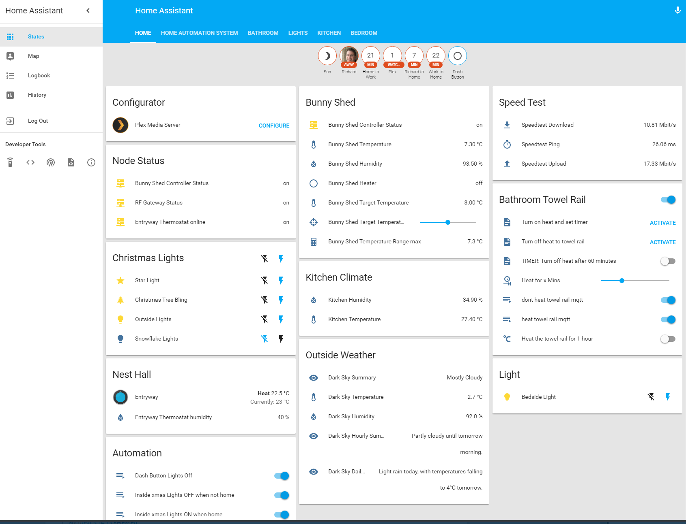
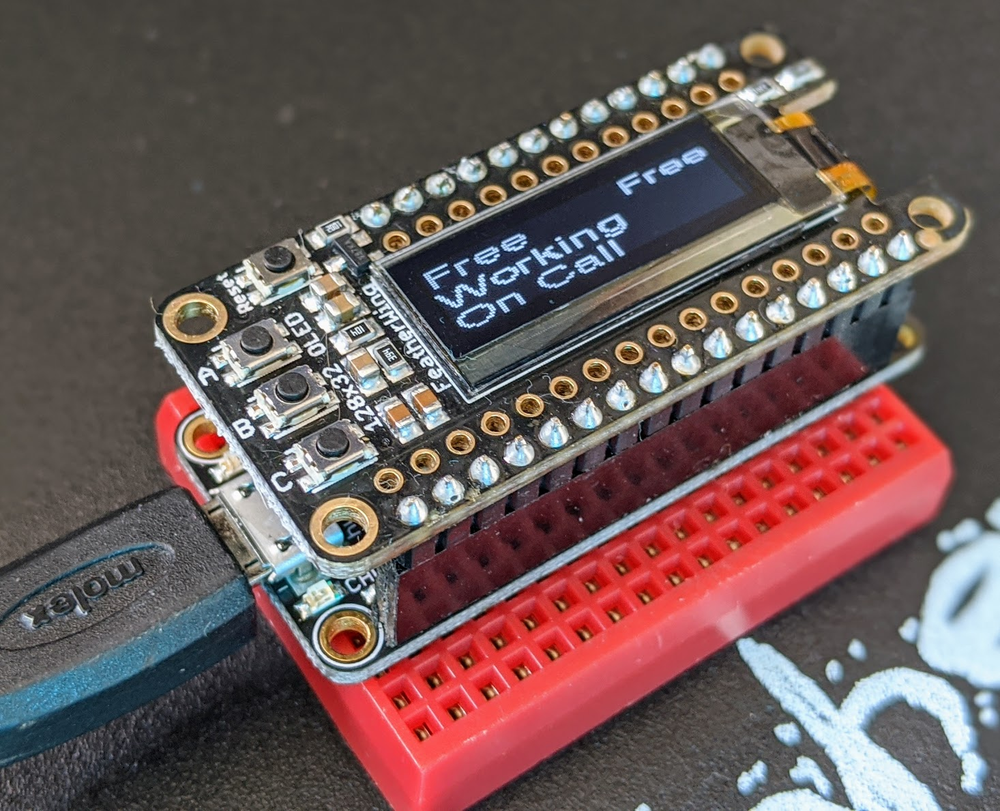
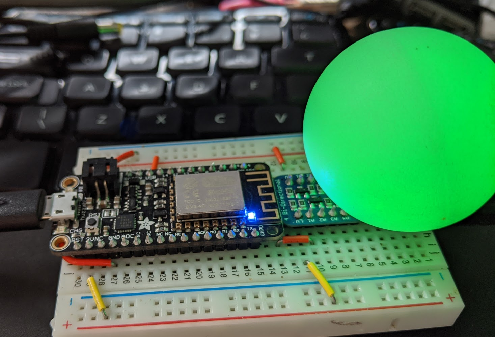
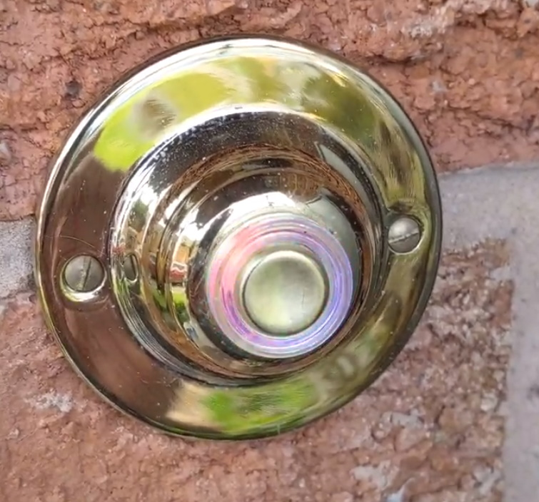
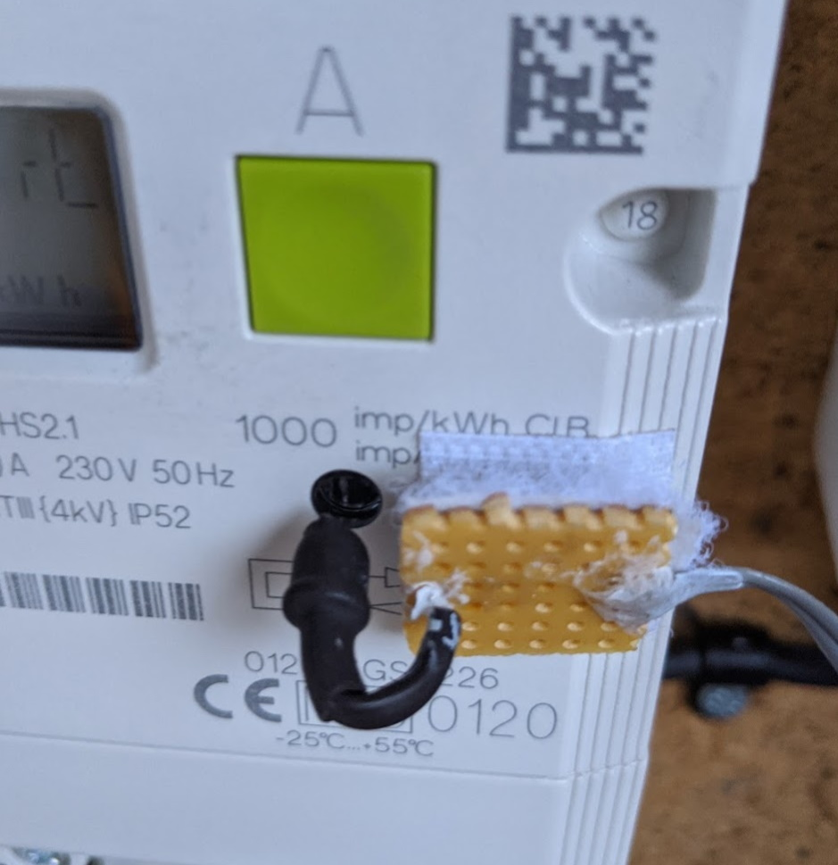

# Home Assistant Configuration

This is the Home Assistant configuration for my house in the UK. It runs solar panels, a home battery and an EV on an Octopus tariff, about 90 Zigbee devices, 17 ESPHome devices I built, a garden irrigation system, and a few chickens and rabbits.

I publish it so you can borrow from it. The ESPHome configs in [esphome/](esphome/) are the most reusable part.

## Contents

- [Home Assistant Configuration](#home-assistant-configuration)
  - [Contents](#contents)
  - [Platform](#platform)
  - [What it does](#what-it-does)
    - [Energy, solar and battery](#energy-solar-and-battery)
    - [Heating and air](#heating-and-air)
    - [Lighting](#lighting)
    - [Doorbell, security and cameras](#doorbell-security-and-cameras)
    - [Garden](#garden)
    - [Health](#health)
    - [Animals](#animals)
    - [Around the house](#around-the-house)
  - [Repository layout](#repository-layout)
  - [ESPHome devices](#esphome-devices)
  - [Zigbee, Matter and RF](#zigbee-matter-and-rf)
  - [Integrations and cards](#integrations-and-cards)
  - [Reusing an ESPHome config](#reusing-an-esphome-config)
  - [Homemade hardware](#homemade-hardware)
  - [History](#history)
  - [Inspiration and support](#inspiration-and-support)
  - [License](#license)

## Platform

- Home Assistant OS in a Hyper-V virtual machine on Windows, built from the official Home Assistant VHDX image and kept on the current release.
- Apps (add-ons): Mosquitto, Zigbee2MQTT, ESPHome Device Builder, Matter Server, Nginx Proxy Manager, AdGuard Home, Network UPS Tools, Vaultwarden, Uptime Kuma, Tautulli, chrony, Samba, Studio Code Server, changedetection.io and the CareLink Token Generator.
- Login uses TOTP multi-factor authentication.
- The recorder keeps 64 days of history and excludes noisy entities (link quality, last seen, AdGuard counters, irrigation inputs).

## What it does

UI-managed automations live in [automations.yaml](automations.yaml), around 60 of them, named `Area - Action` so you can find them. Bigger features live in [packages/](packages/).

### Energy, solar and battery

- Enphase Envoy solar, with Forecast.Solar for production forecasts.
- Eaton xStorage Home battery. Automations set the charge target from the Octopus Intelligent Go schedule, run a two-stage overnight charge, discharge during Octopus saving sessions, and stop the battery if the cells go out of balance.
- The Eaton inverter reads grid power from an ESPHome device that pretends to be an Eastron SDM120CT Modbus meter. See [esphome/sdm120-emulator.yaml](esphome/sdm120-emulator.yaml).
- Octopus Energy rates, a peak/off-peak tariff sensor, and automatic sign-up to Octoplus saving sessions.
- Whole-house power from CT clamps on the consumer unit and Zigbee DIN-rail meters. Powercalc estimates about 45 more devices, and utility meters roll everything up into daily and monthly totals.
- Skoda EV through MySkoda, and grid carbon intensity from CO2 Signal.
- The dishwasher starts overnight on cheap power. The washing machine and tumble dryer send a notification when they finish.

### Heating and air

- Nest thermostat with an away setback. Zigbee radiator valves raise heating demand, and presence controls a heating master switch.
- A Midea air conditioner in the bedroom, controlled locally over ESPHome.
- Two IKEA FÖRNUFTIG air purifiers converted to ESPHome. Fan speed follows PM2.5, and the office one follows my desk power.
- Temperature, humidity and particulate sensors in most rooms, the loft and the shed, plus a mould indicator and Google Air Quality.

### Lighting

- Adaptive Lighting adjusts brightness and colour temperature through the day.
- Motion lighting in the kitchen and outside, with slow fades. Hallway lights come on when we arrive at the front door. Garden lights come on when the back door opens.
- Presence simulation switches random lights on and off while we're away.
- Zigbee remotes and an IKEA BILRESA dial, a bedtime scene, a house sign schedule and Christmas light schedules.

### Doorbell, security and cameras

- Axis IP cameras, streamed through go2rtc, with a weekly reboot.
- An ESPHome doorbell rings the chime, announces on the house speakers, pushes a phone notification and makes the Axis camera place a SIP video call to our phones. Setup notes: [docs/doorbell-sip-video-call.md](docs/doorbell-sip-video-call.md).
- Front door, back door, garage and parcel box sensors notify us when opened while we're out. A perimeter zone alerts on a breach.

### Garden

- [kloggy's HA-Irrigation-Version2](https://github.com/kloggy/HA-Irrigation-Version2) runs the garden zones and adjusts for rain and temperature from OpenWeatherMap. It lives in [packages/kloggy_HA-Irrigation-Version2/](packages/kloggy_HA-Irrigation-Version2/) with a YAML dashboard in [lovelace/](lovelace/).
- An alert fires if the irrigation controller goes offline.
- A sprinkler on the front lawn scares off cats.

### Health

- Medtronic CareLink monitoring for an insulin pump. It warns if the sensor or reservoir won't last the night, or if the pump gets left at home.
- A medication watchdog. A Zigbee contact sensor on the bottle starts a six-hour timer to prevent a double dose. See [packages/medication_watchdog/](packages/medication_watchdog/).

### Animals

- Chicken house: load cells weigh the food and water, and Home Assistant alerts when either runs low. See [packages/chickens/](packages/chickens/).
- Rabbits: climate sensors in the indoor bunny house and a feeding-time announcement.

### Around the house

- UPS through NUT, with low-battery alerts and a weekly calibration run. Mains voltage and server temperature alerts.
- Chest freezer and fridge alerts for high temperature, offline sensors or a door left open.
- A weekly low-battery report for every battery-powered sensor.
- A busy light outside my office shows my Microsoft Teams status.
- A kitchen button starts a tea timer or announces dinner.
- Office blinds run on a schedule and a remote.
- Google Assistant and Google Home, a Gemini conversation agent for Assist, and the MCP server.

## Repository layout

| Path | Contents |
| --- | --- |
| [configuration.yaml](configuration.yaml) | Core config. Loads packages, YAML includes, MQTT, RFLink, Google Assistant and the recorder. |
| [automations.yaml](automations.yaml), [scripts.yaml](scripts.yaml), [scenes.yaml](scenes.yaml) | UI-managed automations, scripts and scenes. |
| [packages/](packages/) | Self-contained features: irrigation, weather, chickens, medication watchdog. |
| [includes/](includes/) | Older YAML split by domain: MQTT entities, RFLink, template sensors, Axis REST commands. |
| [esphome/](esphome/) | ESPHome devices, shared templates in `common/`, fonts and images. |
| [blueprints/](blueprints/) | Blueprints, including the low-battery report and Octopus saving sessions. |
| [lovelace/](lovelace/), [myirrigation.yaml](myirrigation.yaml) | The YAML irrigation dashboard. |
| [themes/](themes/) | The `dark_teal` theme. |
| [docs/](docs/) | Setup notes. |
| [archive/](archive/) | Retired automations and scripts. |

Git ignores secrets, `.storage`, `custom_components`, `www` and the Zigbee2MQTT data, so you won't find them here.

## ESPHome devices

Each file starts with a header comment describing the hardware and features.

| File | Hardware | What it does |
| --- | --- | --- |
| [air-quality-sensor-1.yaml](esphome/air-quality-sensor-1.yaml) | NodeMCU ESP8266 | BME280 and PMS5003T air quality, with UK DAQI. |
| [bedroom-sensors.yaml](esphome/bedroom-sensors.yaml) | NodeMCU ESP8266 | BME280 and PMS5003T for the bedroom. |
| [bedroom-air-conditioner.yaml](esphome/bedroom-air-conditioner.yaml) | SMARTLIGHT SLWF-01pro | Local control of a Midea air conditioner over UART. |
| [busylight-mk2-01.yaml](esphome/busylight-mk2-01.yaml) | M5Stack Atom ESP32 | Office busy light, plus an IR remote for Logitech Z-5500 speakers. |
| [busylight-mk2-02.yaml](esphome/busylight-mk2-02.yaml) | M5Stack Atom ESP32 | Kitchen energy light and OLED: Octopus off-peak windows, solar, house and car battery. |
| [chest-freezer-monitor.yaml](esphome/chest-freezer-monitor.yaml) | Feather HUZZAH ESP8266 | DS18B20 probes inside the chest freezer. |
| [chicken-house-sensors.yaml](esphome/chicken-house-sensors.yaml) | Feather HUZZAH ESP8266 | DHT11 and two HX711 load cells for food and water. |
| [CU-current-clamps.yaml](esphome/CU-current-clamps.yaml) | Feather HUZZAH ESP8266 | SCT-013 CT clamp through an ADS1115 for whole-house power. |
| [doorbell-controller.yaml](esphome/doorbell-controller.yaml) | NodeMCU ESP8266 | Neopixel button, relay for the AC chime, Axis camera I/O trigger. |
| [indoor-bunny-house-sensors.yaml](esphome/indoor-bunny-house-sensors.yaml) | NodeMCU ESP8266 | BME280 in the rabbit house. |
| [living-rm-IKEA-Fornuftig-air-purifier.yaml](esphome/living-rm-IKEA-Fornuftig-air-purifier.yaml) | NodeMCU ESP8266 | Fan speed and filter LED for an IKEA FÖRNUFTIG. |
| [office-IKEA-Fornuftig-air-purifier.yaml](esphome/office-IKEA-Fornuftig-air-purifier.yaml) | NodeMCU ESP8266 | Same purifier mod for the office. |
| [loft-sensors.yaml](esphome/loft-sensors.yaml) | NodeMCU ESP8266 | DHT22 in the loft. |
| [shed-sensors.yaml](esphome/shed-sensors.yaml) | NodeMCU ESP8266 | DHT22 in the shed. |
| [office-blind-controller.yaml](esphome/office-blind-controller.yaml) | WeMos D1 Mini | Relays for open, close, stop and tilt on the office blind. |
| [sdm120-emulator.yaml](esphome/sdm120-emulator.yaml) | ESP32 | Emulates an Eastron SDM120CT so the Eaton inverter can read grid power. |
| [water_meter.yaml](esphome/water_meter.yaml) | Feather HUZZAH ESP8266 | Reads an Itron EverBlu Cyble water meter over 433 MHz with a CC1101. |

Shared templates in [esphome/common/](esphome/common/) keep the device files short:

- `device_base.yaml`, `device_base_wifi.yaml`: API, OTA, Wi-Fi, restart button and diagnostics.
- `status_led.yaml`: status LED, removable with `!remove`.
- `bme280.yaml`, `dht11.yaml`, `dht22.yaml`, `pms5003t.yaml`: sensor blocks.
- `daqi.yaml`: UK Daily Air Quality Index from PM readings.
- `fornuftig.yaml`: the IKEA purifier mod.
- `m5stack_atom_wifi_fix.yaml`: Wi-Fi fix for the M5Stack Atom.

[esphome/common/README.md](esphome/common/README.md) lists the substitutions each template expects.

## Zigbee, Matter and RF

- Zigbee2MQTT on an Ember network coordinator runs about 90 devices: lights, motion and contact sensors, remotes, smart plugs, radiator valves, DIN-rail energy meters and IKEA air quality sensors.
- ZHA runs a second network on a SONOFF Dongle-M.
- Matter and Thread are set up for newer devices.
- An RFLink gateway still drives older 433 MHz devices, with a keep-alive automation: an Energenie MIHO026 wall switch, Maclean and Status remote sockets, and a hacked IKEA E1201C remote that runs the kitchen extractor fan. Energenie MiHome devices also come in over MQTT.

## Integrations and cards

Built-in integrations doing the heavy lifting: ESPHome, MQTT, Zigbee (ZHA), Matter, Nest, Axis, Enphase Envoy, Forecast.Solar, Google Assistant, Google Cast, Android TV, SmartThings, Tuya, Synology DSM, NUT, AdGuard, OpenWeatherMap, Met.no, and plenty of template, utility meter and integration helpers.

Custom integrations from HACS:

- [Octopus Energy](https://github.com/BottlecapDave/HomeAssistant-OctopusEnergy)
- Eaton Battery Storage
- MySkoda
- CareLink
- Powercalc
- Adaptive Lighting
- Scheduler
- Sun2
- Browser Mod
- Google Home
- Google Maps
- RFLink UI
- Google Assistant manual UI

Dashboard cards include Mushroom, Bubble Card, card-mod, ApexCharts, auto-entities, layout-card, mini-graph-card, Power Flow Card Plus, Energy Flow Card Plus, Sankey Chart, the Octopus Energy rates card and the scheduler card.

## Reusing an ESPHome config

1. Copy the device YAML and the `common/` files it includes into your ESPHome folder.
2. Change `name`, `friendly_name` and the network substitutions.
3. Add your own `secrets.yaml` with Wi-Fi, API and OTA keys. None are in this repo.
4. Change the GPIO pins to match your wiring.
5. Flash over USB the first time, then OTA.

Display projects need the matching files from [esphome/fonts/](esphome/fonts/) and [esphome/images/](esphome/images/).

| Busy light controller | Busy light |
| --- | --- |
|  |  |

| Doorbell with Neopixel button | Early non-invasive meter sensor |
| --- | --- |
|  |  |

## Homemade hardware

These projects have their own repositories:

- [SDM120CT-Modbus-Emulator-ESP32](https://github.com/genestealer/SDM120CT-Modbus-Emulator-ESP32): the original Arduino version of the SDM120 emulator.
- `Home-Assistant-RFLink-Gateway-ESP8266`: firmware for the RFLink gateway.
- `ESP8266-433Mhz-Controller-Gateway`: a 433 MHz MQTT transmitter.
- `Bunny-Shed-Climate-Control`: a 433 MHz heater controller for the rabbit shed.
- `Controllino-Irrigation` and `Irrigation-Controller`: earlier irrigation hardware.

## History

1. Python on Windows 10, inside Hyper-V on Windows Server 2016.
2. A Python virtual environment on Ubuntu Server 16.04, managed with [hassctl](https://github.com/dale3h/hassctl).
3. Hass.io in Docker on Ubuntu Server 18.04.
4. Hass.io on a Raspberry Pi 4.
5. Home Assistant OS in a Hyper-V virtual machine, using the official image.

## Inspiration and support

- [Graeme Smith](https://github.com/Instagraeme)
- [Johan Bloemberg](https://github.com/aequitas)
- [kloggy](https://github.com/kloggy) for the irrigation package

## License

See [LICENSE.txt](LICENSE.txt) before reusing code in a product.
